# 15 — Hey Foxy V2: revisión de Intelligence Home y Social Explorer

| Propiedad | Valor                                                                                                           |
| --------- | --------------------------------------------------------------------------------------------------------------- |
| Fecha     | 2026-11-21                                                                                                      |
| Rama      | `feat/heyfoxy-v2-uxui`                                                                                          |
| WO        | V2-01, V2-02, V2-03, V2-04 y V2-06 (autorizadas el 2026-11-20). **Solo local; sin Preview ni Production**       |
| Datos     | Modo demo (sintéticos en memoria), reloj fijo en `2026-11-14T15:00Z`. Mismas consultas que en Supabase QA       |
| Capturas  | Reales, generadas por `tools/heyfoxy-qa` (Chrome, página completa). Versionadas en `tools/heyfoxy-qa/baseline/` |

## 1. Antes y después

«Antes» es el tema Clásico (V1, línea base de Gate 2), que sigue disponible como alternativa (D-1). «Después» es la V2 en tema claro (por defecto) y oscuro.

### Intelligence Home (`/`, integra el antiguo Resumen)

| Antes · 1440 px                                                                        | Después · claro · 1440 px                                                                  |
| -------------------------------------------------------------------------------------- | ------------------------------------------------------------------------------------------ |
| 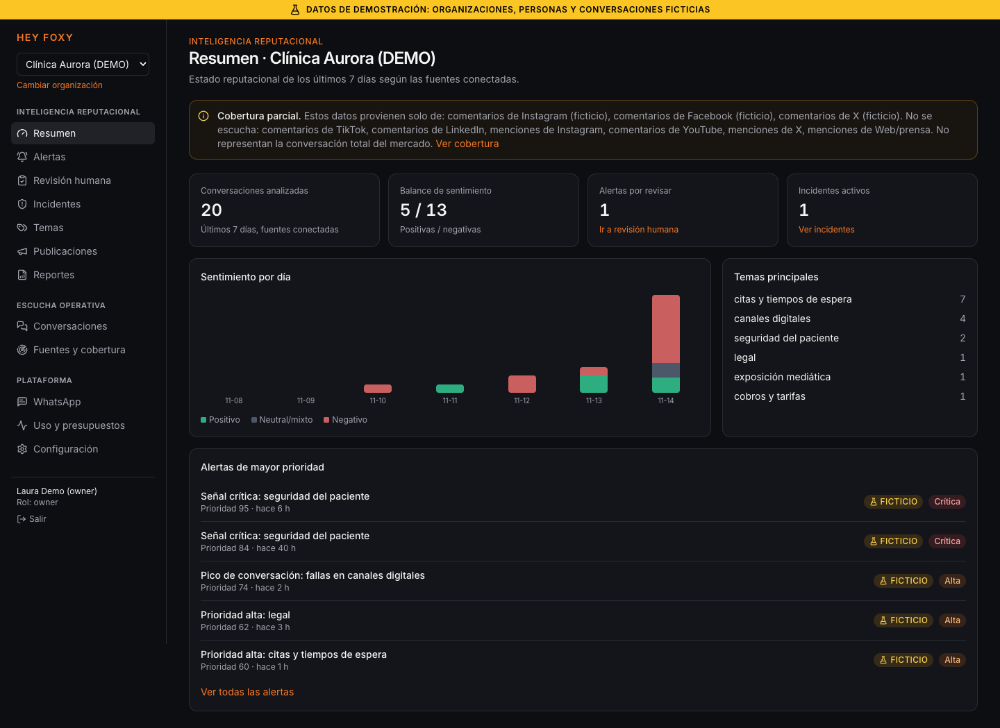 | 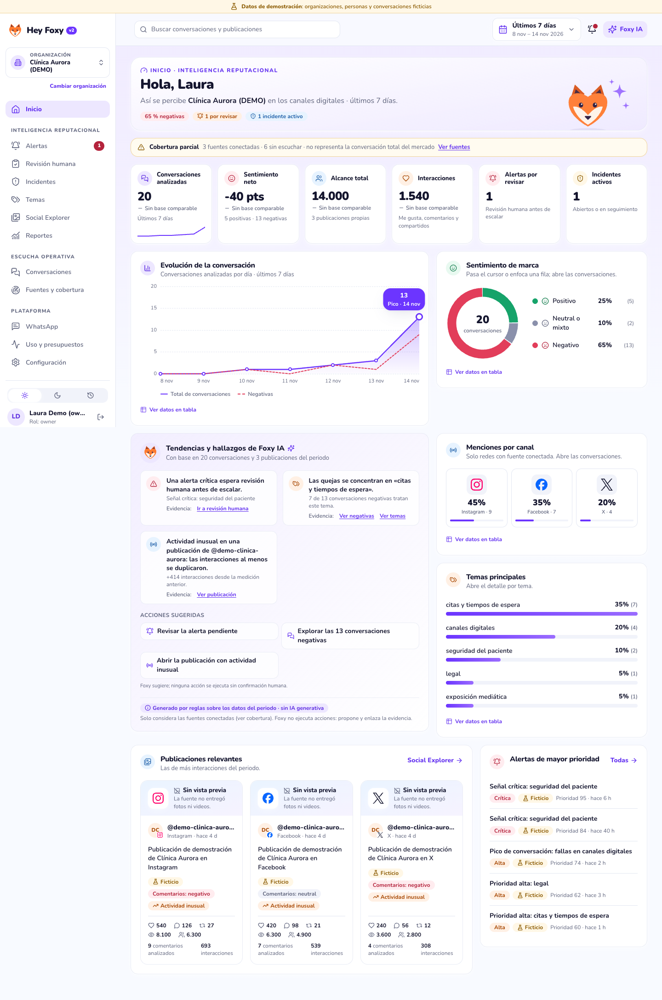 |

| Después · oscuro · 1440 px                                                                 | Antes · 390 px                                                                             | Después · 390 px                                                                          |
| ------------------------------------------------------------------------------------------ | ------------------------------------------------------------------------------------------ | ----------------------------------------------------------------------------------------- |
| 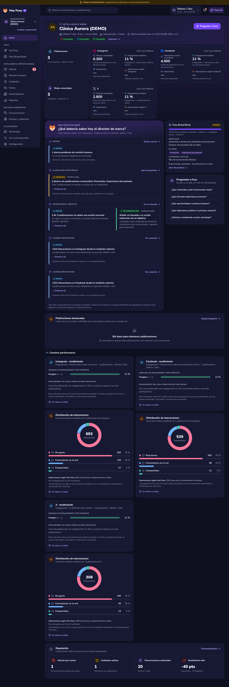 | 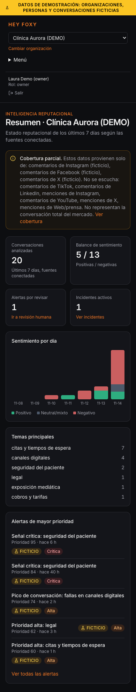 | 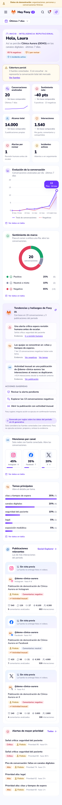 |

Tablet (820 px): [`v2-light-820/resumen.png`](../../../tools/heyfoxy-qa/baseline/screenshots/v2-light-820/resumen.png).

### Social Explorer (`/publicaciones`)

| Antes · 1440 px                                                                                    | Después · claro · 1440 px                                                                      |
| -------------------------------------------------------------------------------------------------- | ---------------------------------------------------------------------------------------------- |
| 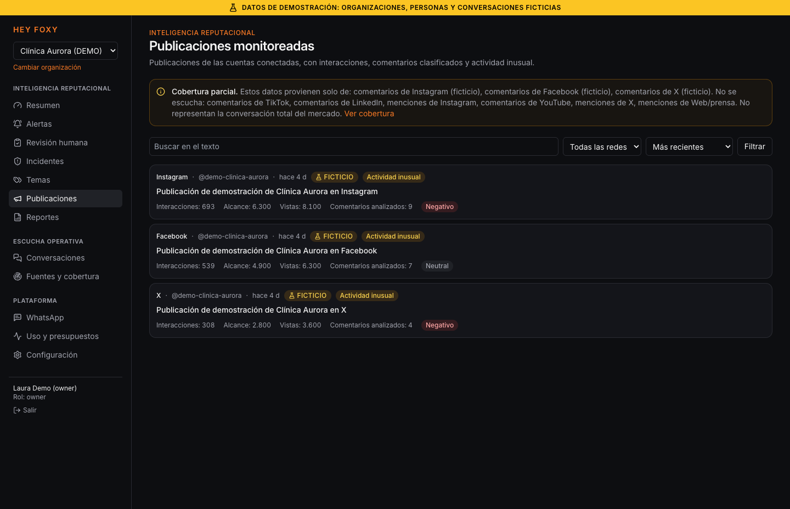 | 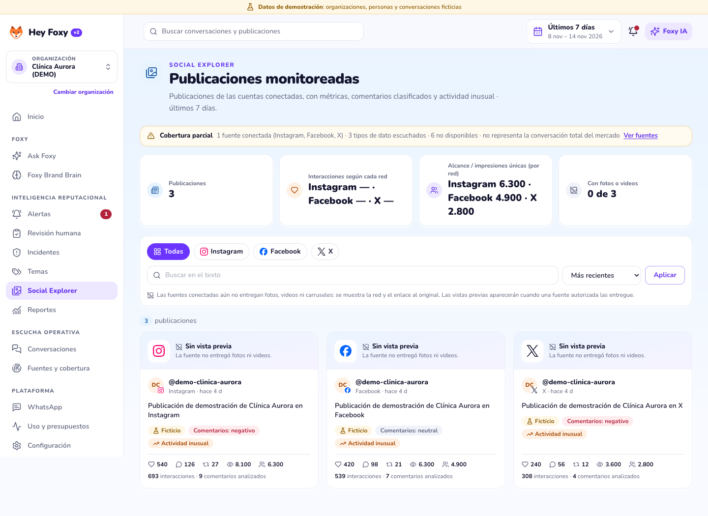 |

| Después · oscuro · 1440 px                                                                           | Después · 390 px                                                                                    |
| ---------------------------------------------------------------------------------------------------- | --------------------------------------------------------------------------------------------------- |
| 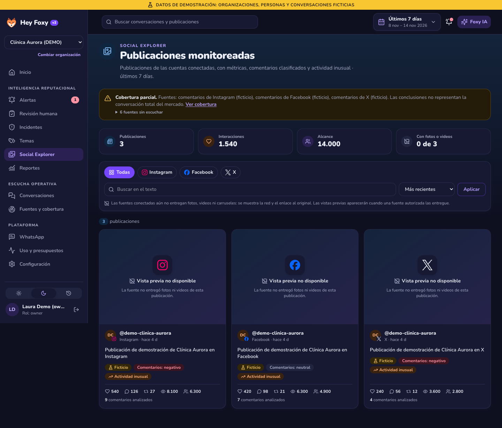 | 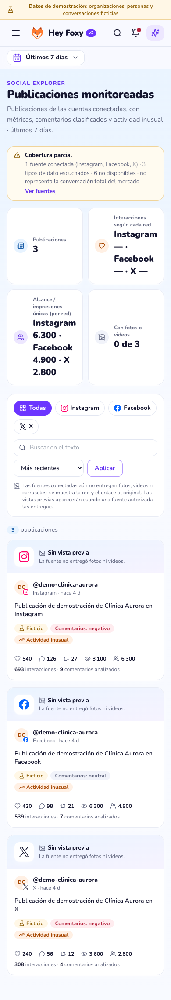 |

### Detalle de publicación (`/publicaciones/[id]`)

| Antes · 1440 px                                                                                    | Después · claro · 1440 px                                                                           |
| -------------------------------------------------------------------------------------------------- | --------------------------------------------------------------------------------------------------- |
| 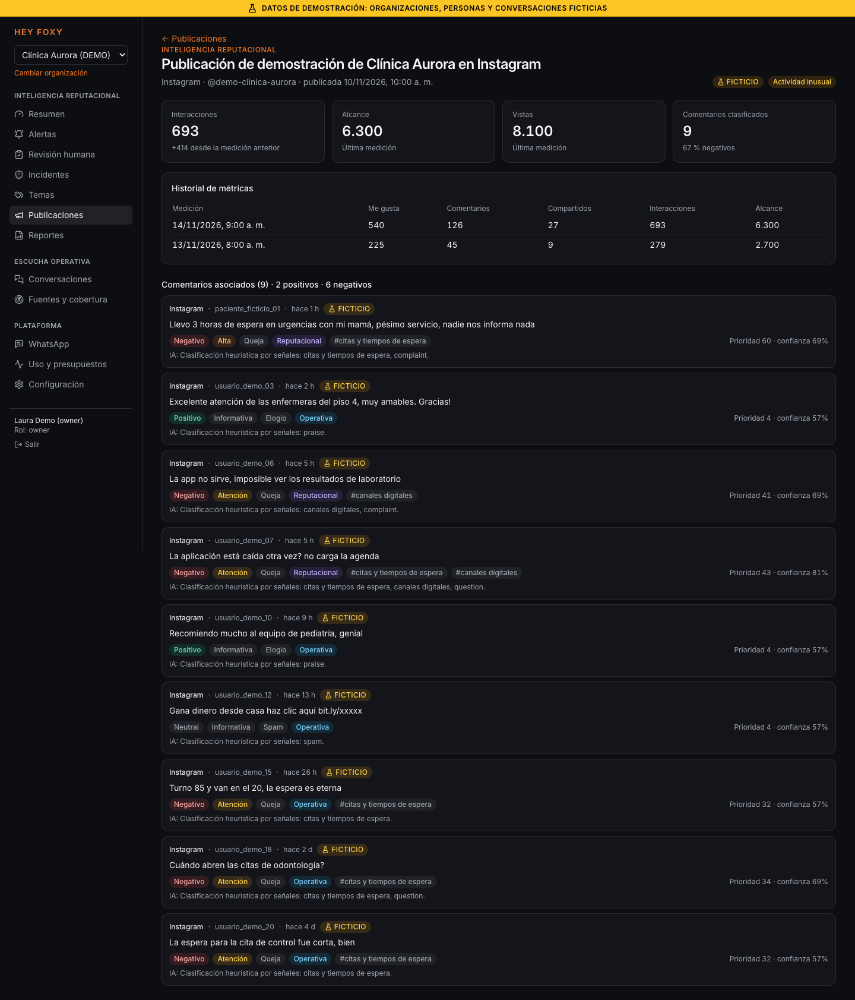 | 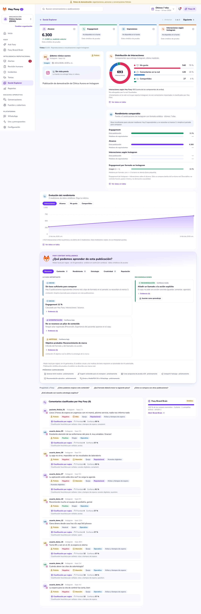 |

Más: [`v2-dark-1440/publicacion-detalle.png`](../../../tools/heyfoxy-qa/baseline/screenshots/v2-dark-1440/publicacion-detalle.png), [`v2-light-390/publicacion-detalle.png`](../../../tools/heyfoxy-qa/baseline/screenshots/v2-light-390/publicacion-detalle.png) y el catálogo de componentes [`v2-light-1440/catalogo-ds.png`](../../../tools/heyfoxy-qa/baseline/screenshots/v2-light-1440/catalogo-ds.png).

## 2. Qué se ve y de dónde sale cada dato

| Elemento                               | Fuente                                                 | Regla de veracidad                                                                            |
| -------------------------------------- | ------------------------------------------------------ | --------------------------------------------------------------------------------------------- |
| KPI de conversaciones y sentimiento    | `items()` + `sentimentBreakdown`                       | Delta solo con periodo anterior con datos; si no, «Sin base comparable»                       |
| Alcance e interacciones                | Última medición de `post_metric_snapshots`             | Alcance «—» si ninguna publicación lo trae (nunca 0 inventado)                                |
| Evolución, sentimiento, temas, canales | `dailySentiment`, `topTopics`, `channelBreakdown`      | Tabla accesible en cada gráfico; drill-down a Conversaciones o Temas                          |
| Hallazgos de Foxy IA                   | `foxyFindings` (reglas deterministas)                  | Cada hallazgo cita su base y su evidencia; etiqueta «Generado por reglas · sin IA generativa» |
| Medios de publicaciones                | `Post.media` (opcional, ninguna fuente lo entrega hoy) | Fallback «Vista previa no disponible» y aviso «0 de N con fotos o videos»                     |
| Autores                                | `accountHandle` / `authorDisplay`                      | Iniciales; nunca fotos de perfil inventadas                                                   |

En el demo todos los KPI muestran «Sin base comparable»: el seed sintético no tiene datos en el periodo anterior. Es el comportamiento correcto, no un fallo.

## 3. Resultado de las pruebas (HEAD `cc45e92`)

| Prueba                                   | Resultado                                                                                                           |
| ---------------------------------------- | ------------------------------------------------------------------------------------------------------------------- |
| Typecheck y lint                         | Verde                                                                                                               |
| Unitarias                                | **88/88** (60 previas + 28 nuevas: tema, periodo, componentes, Home)                                                |
| SQL local (Postgres efímero)             | **122/122**, contrato OK (sin cambios de esquema)                                                                   |
| Build demo y Supabase (relleno, sin red) | Verde, `check-trace` OK                                                                                             |
| Smoke HTTP (demo)                        | **49/49** (40 previas + 9 de V2: tema clásico, tema inválido, catálogo, aislamiento del buscador, periodo inválido) |
| QA visual, axe y funcional               | **138/138** en 8 proyectos (3 clásicos + 3 claros + 2 oscuros) × 18 vistas                                          |
| Accesibilidad (axe WCAG 2.2 A/AA)        | **0 violaciones graves o críticas en todos los proyectos** (antes: 2 reglas de deuda)                               |
| Contraste de tokens                      | 68 pares AA, claro y oscuro                                                                                         |
| Desbordamiento horizontal                | 0 en todas las vistas y anchos                                                                                      |
| Capturas clásicas                        | Sin cambios salvo Configuración (tarjeta «Apariencia»)                                                              |

## 4. Pendientes

- **Gate D sigue abierto** (validación manual de Álvaro del Preview n.º 4). Nada de V2 está desplegado.
- **Validación con Supabase QA:** las vistas usan exactamente las mismas consultas del repositorio que V1 (sin métodos nuevos), pero la verificación con datos de `heyfoxy-qa` y RLS solo es posible en un Preview (requiere GO por SHA) o con un inicio de sesión manual de Álvaro.
- **Vistas aún no migradas** (V2-05 Reportes, V2-07 Conversaciones, V2-08 War Room, y Plataforma): heredan los tokens y el shell V2, pasan axe, pero mantienen su maquetación V1.
- **Medios reales:** requieren un conector autorizado (Metricool u otro) y una migración para almacenarlos, cada uno con su GO.
- **Alcance y periodo:** con 30/90 días el seed demo no aporta más datos; la comparabilidad real se verá con datos acumulados.
